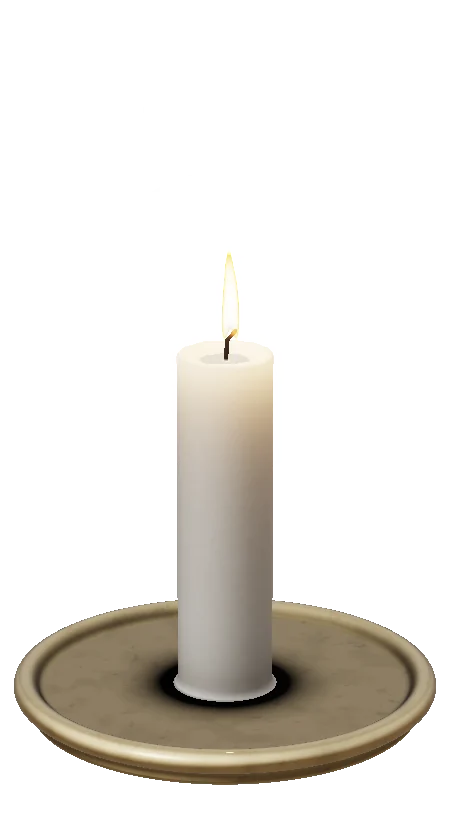
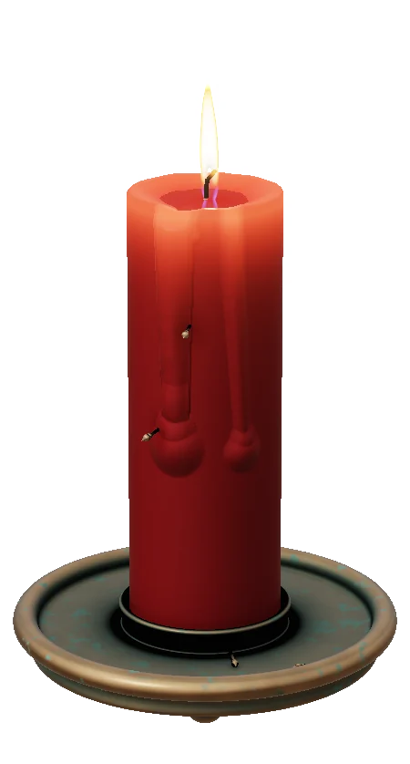
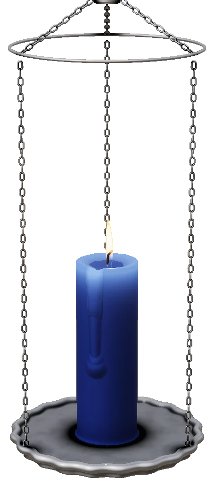

# Cera

Cera is a floating candle timer for focus. Set the candle’s height, click the wick, and work while it burns down. The wax gives you a sense of how much time is left.

[Explore the Cera site](https://cera-app.leopoldogastel.workers.dev) · [Download Cera and Cera Lite · 0.2.5](https://github.com/penny-dealer-fr/Cera/releases/tag/v0.2.5) · [Cera Flame and Cera Smoke](https://github.com/penny-dealer-fr/Cera/releases/tag/v0.2.4)

[Apple Silicon 0.2.6 preview and Cera CLI](https://github.com/penny-dealer-fr/Cera/releases/tag/v0.2.6-preview.1)

  
  
  

## Choose your edition

- **Cera Lite** is recommended for everyday use. It keeps every candle, feature, and unlock with lower rendering load.
- **Cera** offers the same experience at full rendering quality. Both share the same local profile, including your active candle.
- **Cera Flame** uses Lite’s 3D white candle and brass saucer. Drag the top to set the burn from 5 minutes to 10 hours.
- **Cera Smoke** is the 2D edition with movable plates and a slider and numeric duration input. It keeps your original Flame candle and stats.

Both Flame and Smoke have simple burn stats. Completed burns earn Clear Wax deeds in Cera and Cera Lite. All seven count toward Every Last Thing.

## How it works

- **Set your time.** Drag the top of the candle to change its height. White runs from 5 minutes to 1 hour, blue from 1 to 3 hours, red from 3 to 5 hours, and black from 5 to 10 hours. Use an exact timer or add a little uncertainty.
- **Mark a moment with a pin.** Push a pin into the wax. When the flame reaches it, the pin drops and ticks against the holder.
- **Keep it in view.** The candle floats above your work. Drag it to a screen edge to dock it on chains, in a side sconce, or on a candlestick.
- **Visit the Hall of Candles.** See your burn totals and deed progress. Some deeds award new plates, and seasonal candles come and go through the year.

This repository hosts production downloads and release notes. The preview is available for Apple silicon Macs, Intel Macs, and Windows x64.

[Updating Cera and keeping your progress](UPDATING.md)
